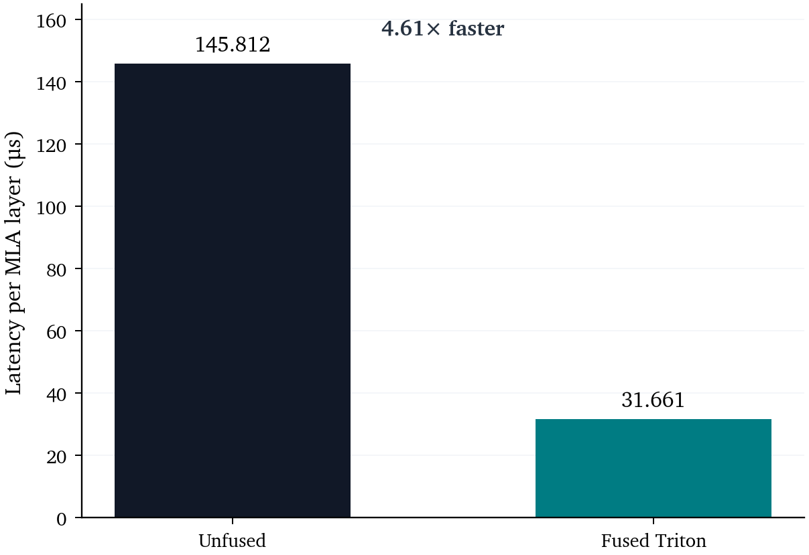
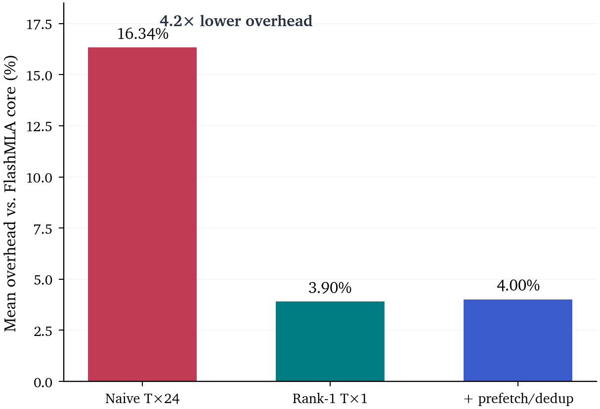
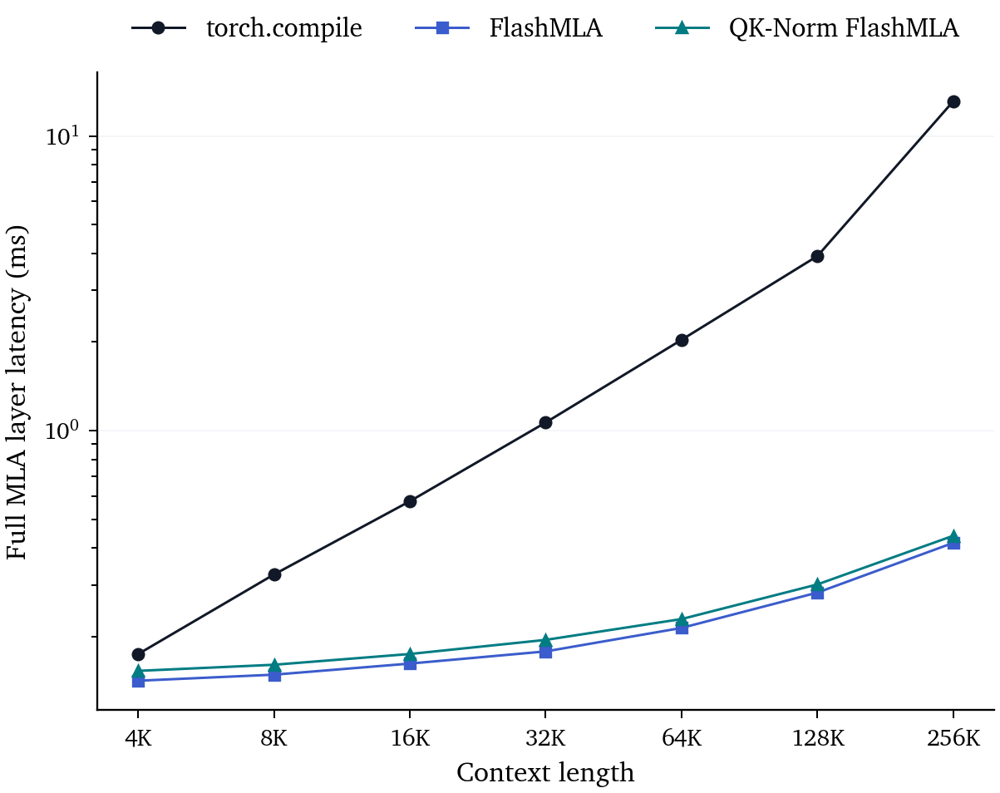

# XTuner QK-Normed MLA Decode Kernel 交付

## 1. 范围与语义边界

本分支基于原始 FlashMLA `9241ae3`，QK-Norm kernel 实现为 `e0a2c6d`，H200 实验记录为 `418c9c3`。它支持 SM90 dense decode 的 rank-1 QK-Norm：每 token、每 KV-group 保存一个 FP32 `alpha_k`；MLA 只有一个 KV-group，因此 sidecar 为 `[num_blocks,64]`。调用方将 query scale `alpha_q` 折叠进 content query，RoPE score 与 latent V 不缩放。

该语义与 Qwen 的 per-token、per-query-head `T×H` scale 不同。若 XTuner 模型的 K RMS 分母随 head 改变，必须保留 head 维，不能直接广播为 `T×1`。

## 2. Decode 数据流

```text
上游生成 absorbed content query 与 RoPE query
    → 写入 latent KV、RoPE key 和 alpha_k sidecar
    → FlashMLA 累加 8 个 content tile
    → content score × alpha_k
    → 累加第 9 个 RoPE tile
    → online softmax 与 latent V reduction
```

## 3. 优化步骤与收益

不同实验的 denominator 不同：attention-core 只计 `flash_mla_with_kvcache`；full-layer 还包含 projection；Qwen 整模型还包含其他层。下表不把这些百分比直接相加。

| 阶段 | 改动 | 主要作用 | 实测结果 |
|---|---|---|---|
| 原始 FlashMLA | 9 个 64-d tile 连续进入 WGMMA，前 8 个是 content，最后一个是 RoPE | 无 QK-Norm | 对照组 |
| 正确性版本 `T×24` | 每 token、每 query head 保存 FP32 scale；全部 content tile 完成后缩放，再加入 RoPE | 精确支持 per-head scale | attention-core 平均开销 **16.34%**，范围 1.01%～23.0% |
| NCU 定位 | 分解 DRAM、register、occupancy 与 warp stall | 确认不是单一算术瓶颈 | DRAM bytes +8.1%～9.1%，register 240→254；低 occupancy 下新增 load、drain 和依赖乘法难以隐藏 |
| Rank-1 `T×1` | 利用 per-KV-group 语义，24 个 head 共享一个 token scale | 去掉 24 倍冗余 sidecar | attention-core 平均开销降至 **3.90%**，约降低 **4.2×**；DRAM 增量降至 0.4%～0.7%，register 降至 242 |
| Load prefetch + dedup | 在 `warpgroup_wait<0>` 前发出合并后的 `float2` scale load | 尝试隐藏 global-load latency | 3.90%→4.00%，在噪声内，**未证明更快**；仍保留 content drain→scale→RoPE 依赖 |
| RoPE 独立 accumulator | 保留原 tile 顺序，使用 `rP_rope` 暂存位置分数 | 尝试消除中间 pipeline bubble | steady-state 达 255 registers，产生 20 B spill load/store；未进入正式性能矩阵，已回退 |
| Megatron 前端融合 | 一个 Triton kernel 合并 Q-content/Q-pos/K-pos RMSNorm、gamma、RoPE 和 layout conversion | 减少小 kernel launch 与中间张量读写 | B=16 单 MLA 层 **145.812→31.661 μs，4.61×** |
| Projection 布局优化 | Query absorption 与 V up-projection 从 `einsum` 改为 head-major `bmm`；权重预先 contiguous | 避免隐式 permute、packing 和临时 copy | 无独立 A/B；收益包含在 Qwen 整模型结果中 |
| 最终 Qwen 路径 | 前端融合、RoPE cache、`bmm` 与 latent-cache decode 合并 | 降低端到端 decode 掉点 | 19 个常规点相对 GQA 几何平均下降 **4.61%**；此前约 10.61%，但重复次数不同，不是严格同条件 A/B |



前端融合的收益主要来自减少 kernel launch 和显存往返，而不是减少大量 FLOPs。对应 Megatron 实现在 `concept_olmo/repo/megatron/core/fusions/fused_mla_yarn_rope_apply.py`。



`T×24` 每 token 多读 `24×4=96 B` scale，而 BF16 576-d KV 为 1152 B，理论增量约 8.33%，与 NCU 的 8.1%～9.1% 一致。Rank-1 `T×1` 将 sidecar 降到 4 B/token，但仅适用于所有 query head 共享 K scale 的模型语义。

## 4. 完整 MLA 层结果

DeepSeek-V3.2 宽度、TP=8、B=4、BF16 的完整层测试中，QK-Norm 相对 FlashMLA 的平均开销为 7.53%；相对 `torch.compile` 的平均开销为 2.19%，32K 及以上低于 2%。同一 kernel 因 baseline 不同会得到不同百分比，交付时必须注明 denominator。



## 5. 代码位置

- `flash_mla/flash_mla_interface.py`：Python `qk_norm_scale_cache` 接口。
- `csrc/api/dense_decode.h`、`csrc/params.h`：sidecar shape、dtype、pointer 与 stride。
- `csrc/sm90/decode/dense/splitkv_mla.cuh`：scale prefetch/apply、content/RoPE tile 顺序和 `<T,true>` dispatch。
- `tests/test_flash_mla_qk_normed_dense_decoding.py`：`alpha_k=1` bit-exact gate 与随机 rank-1 等价性。
- `benchmarks/qknorm/RESULTS.md`：正式结果摘要。
- `benchmarks/qknorm/results/`：CSV、manifest 与 NCU 指标。
- `benchmarks/qknorm/plot_xtuner_handoff.py`：本文图表生成脚本。

## 6. 验证与复现

```bash
python tests/test_flash_mla_qk_normed_dense_decoding.py
python benchmarks/qknorm/bench_qknorm_module.py
python benchmarks/qknorm/plot_xtuner_handoff.py
```

正确性门槛是 `alpha_k=1` 时与原 FlashMLA bit-exact，随机 `alpha_q×alpha_k` 时与显式 reference 一致。完整原始数据和负向尝试均保留在 `benchmarks/qknorm/`，本次未重新启动 GPU 实验。
